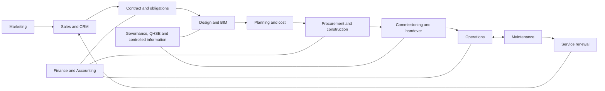

# Construction BIM

Requirements and architecture baseline for a construction lifecycle web application spanning **Marketing, Sales, Land, Engineering/BIM, Planning, Procurement, Construction, Finance, Accounting, Operations and Maintenance**.

**Status:** documentation and proposed workflows. No application or autonomous agents are implemented in this repository.

## Start here

Read [Solution map and technical scope](doc/08_SOLUTION_MAP.md) first. It shows what each module captures, how records connect, what agents may do, and the first implementation slice.

This diagram shows major handoffs. Actual packages overlap; Finance, Planning and governance apply throughout.

## Documents

- [Solution map and technical scope](doc/08_SOLUTION_MAP.md) — module/data boundaries, diagrams, architecture and pilot acceptance.
- [Marketing and service lifecycle requirements](doc/09_MARKETING_AND_SERVICE_LIFECYCLE.md) — explicit Marketing, Sales, Operations and Maintenance use cases and acceptance.
- [Business requirements](doc/01_BRD.md).
- [Product requirements](doc/02_PRD.md).
- [Functional specification](doc/03_FUNCTIONAL_SPECIFICATION.md).
- [Module and governance catalog](doc/04_MODULE_AND_GOVERNANCE_CATALOG.md).
- [BIM components and agent orchestration](doc/07_BIM_AND_AGENT_ORCHESTRATION.md).
- [Research and design rationale](doc/05_RESEARCH_AND_DESIGN_RATIONALE.md).
- [Original overall plan](doc/00_READ_ME.md).
- [Visual guide HTML](doc/06_VISUAL_MAPS.html) — download/open locally; GitHub does not run it as an application.
- [Snowflake diagram](doc/snowflake.svg), [fishbone diagram](doc/fishbone.svg), [workflow diagram](doc/workflow-map.svg).

The module catalog now includes M17 Marketing. Document 09 adds BR13, PR16–PR19 and workflows WF11–WF14; it supplements the original baseline. Historical diagrams retain the original 16-segment grouping; use the solution map for the expanded scope.

## Implementation boundary

Use a transactional workflow core, controlled documents/models, explicit system-of-record ownership and versioned APIs/events. Integrate existing authoring, scheduling, CRM, ERP and asset systems where retained. Agents retrieve, validate, draft and coordinate; authorised people approve engineering, financial commitments, safety and return to service.

The first pilot must trace a marketing-sourced opportunity through contract, one delivery package, billing/reconciliation, asset acceptance, one maintenance order and a service-renewal task. See the solution map for the acceptance conditions.

## Open decisions

Company role and pilot asset; countries/entities; retained systems; approval authorities; scale and hosting. No stack, delivery date, ROI or regulatory certification is committed.

## Archive

[Original blueprint ZIP](doc/construction-lifecycle-blueprint.zip) is a historical snapshot from 26 October 2026. Current Markdown files include subsequent additions. Do not use the ZIP as the current source of truth.
