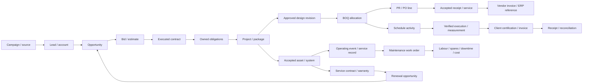
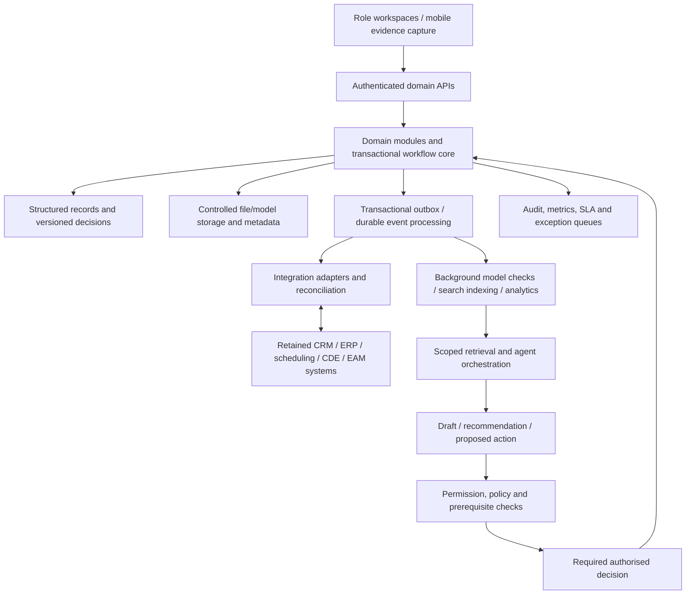
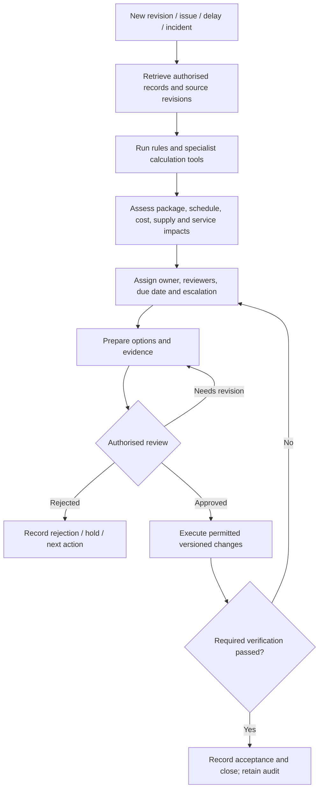

# Solution map and technical scope

Version 0.2 | 27 October 2026 | Proposed requirements baseline

## 1 Scope in one paragraph

A construction lifecycle web application connecting **market demand to contract, design to delivery, and commissioned assets to operating service and maintenance**. BIM supplies controlled engineering/asset information. CRM, commercial, planning, financial and service records remain explicit business domains. This is a requirements repository; implementation and integration choices remain open.

## 2 What is captured under each domain

```mermaid
flowchart TB
    ROOT["Construction lifecycle platform"]
    ROOT --> GROW["Growth and commercial"]
    ROOT --> ENG["Site and engineering"]
    ROOT --> CTRL["Planning and financial control"]
    ROOT --> DEL["Supply and delivery"]
    ROOT --> SERV["Asset service lifecycle"]
    ROOT --> GOV["Shared governance"]

    GROW --> M17["M17 Marketing: campaigns, sources, content approvals, attribution"]
    GROW --> M01["M01 Sales/CRM: accounts, opportunities, bids, renewals"]
    GROW --> M11["M11 Commercial: contracts, obligations, notices, certification"]

    ENG --> M02["M02 Land: parcels, rights, access, clearance conditions"]
    ENG --> M03["M03 BIM/Engineering: requirements, models, revisions, issues"]
    ENG --> M07["M07 BOQ/Cost engineering: quantities, rates, allocations"]

    CTRL --> M04["M04 Planning: WBS, logic, baselines, constraints, progress"]
    CTRL --> M05["M05 Finance: funding, budget, commitments, EAC, cash"]
    CTRL --> M06["M06 Accounting: AP/AR, ledger references, close, asset accounting"]

    DEL --> M08["M08 Procurement: PR, RFQ, evaluation, PO, expediting"]
    DEL --> M09["M09 Stores: receipts, quarantine, reservations, issues, returns"]
    DEL --> M10["M10 Construction: readiness, daily evidence, measurements, rework"]

    SERV --> M13["M13 Commissioning: tests, punch lists, manuals, acceptance"]
    SERV --> M14["M14 Operations: shifts, service output, incidents, downtime"]
    SERV --> M15["M15 Maintenance: plans, work orders, spares, failures, warranty"]

    GOV --> M12["M12 QHSE: inspections, permits, holds, corrective actions"]
    GOV --> M16["M16 Governance: identity, authority, RACI, SLA, audit, integrations"]
```

M17 is an explicit extension of the initial 16-segment catalog. Marketing is a separate process domain even if one team performs both Marketing and Sales. M12/M16 apply across every domain; placement in a diagram does not restrict their reach.

## 3 The record chain

Arrows denote traceability, not compulsory one-to-one relationships or automatic authority. Many-to-many mappings need allocation/link records. A client invoice can follow another contractually approved billing basis. An asset may have many documents and model elements; non-modelled scope is allowed.

**Common keys:** entity, party, project, location/chainage, package/WBS, activity, cost account, document/model revision, BOQ line, order line, asset tag and workflow instance. Preserve source-system IDs and revisions. Store currency, units, effective dates and evidence provenance explicitly.

**Important distinctions:** pipeline ≠ signed backlog; BOQ demand ≠ stock; installed quantity ≠ accepted quantity; progress ≠ client certification; EAC ≠ cash; invoice ≠ recognised revenue; commissioning completion ≠ operating custody; revised drawing ≠ resolved issue.

## 4 Reference application architecture

**Starting architecture:** modular application with explicit domains, a relational transactional core, versioned object storage and background processing. These are design recommendations, not selected products. Extract services when actual load or team ownership warrants it.

**Source ownership:** choose one authoritative system per object/field before integration. Existing systems remain authoritative where retained. ERP owns posted books/payment status; engineering authoring/CDE owns its approved information where retained; scheduling engine owns calculation where retained. The platform owns only explicitly assigned workflow/domain records. No unrestricted dual-master writes.

**Integration contract:** schema/version, source/target owner, identifiers, cadence, permissions, idempotency, retries, failure queue, reconciliation and support owner. Database change and outgoing event must not diverge; use transactional outbox or equivalent. Replayed events must not create duplicate orders, postings or work orders.

## 5 Agent orchestration and issue closure

Agents may classify, retrieve, compare, group duplicate issues, draft requests, assemble impacts, route tasks and remind owners. Deterministic rules handle predictable controls; scheduling/engineering tools calculate; evaluated ML predicts; generative AI interprets and drafts.

An agent cannot infer engineering approval, contract commitment, payment authority, safety clearance or return to service from an email or uploaded document. Each controlled transition requires its configured authority. Incoming document instructions are untrusted content. AI outputs must retain sources, revision/as-of date and review status.

## 6 First implementation slice

Use one project, one delivery package and one maintained asset. Allow manual imports/entries where integrations are not yet proven, while preserving source and review status.

1. Capture a campaign/source, lead and qualified opportunity; retain attribution and applicable contact preferences.
2. Approve a bid and executed contract; transfer scope, exclusions and service commitments into owned obligations.
3. Publish a design revision and approved BOQ/budget/schedule baseline; specify operating/maintenance data requirements.
4. Process one PR/PO, partial receipt, inspection and invoice exception; reconcile the authorised ERP transaction without duplicates.
5. Verify work and client billing basis; preserve disputed amounts and cash status separately.
6. Commission the asset with mandatory documents, training and explicit operating custody acceptance.
7. Record an operating incident, maintenance order, spare/labour cost, test and authorised return to service.
8. Create a service-renewal opportunity; prepare an approved project-reference candidate for Marketing.

**Exit evidence:** complete traceable records; process-owner UAT; cross-project permission isolation; self-approval rejection; failed-test hold; replay/idempotency test; backup/restore; and an exception queue with named owners. No predictive model or autonomous engineering is needed for this pilot.

## 7 Decisions required before build estimates

- Company role: EPC, developer, owner-operator or concessionaire; contractual boundaries.
- Pilot asset and package; participating client/supplier roles.
- Countries, entities, currencies, local obligations and accounting policies.
- Retained CRM, ERP, CDE/BIM, scheduling and maintenance systems; supported interfaces.
- Role/authority matrix, data ownership, SLAs and emergency operating procedures.
- Representative file sizes, load, connectivity, hosting, recovery and retention requirements.

## 8 Detailed references

[BRD](01_BRD.md) · [PRD](02_PRD.md) · [Functional specification](03_FUNCTIONAL_SPECIFICATION.md) · [Governance catalog](04_MODULE_AND_GOVERNANCE_CATALOG.md) · [Agent opportunities](07_BIM_AND_AGENT_ORCHESTRATION.md) · [Marketing and service requirements](09_MARKETING_AND_SERVICE_LIFECYCLE.md) · [Research](05_RESEARCH_AND_DESIGN_RATIONALE.md)
